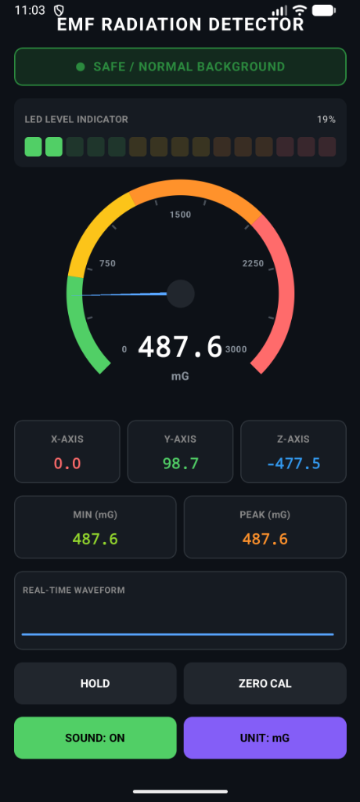
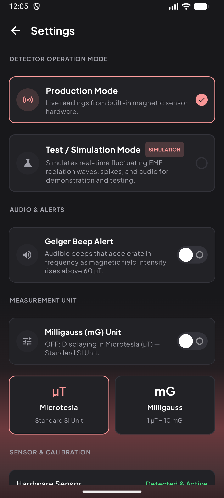

# EMF Pulse ⚡
### Modern Electromagnetic Field & Radiation Detector for Android

<p align="center">
  
</p>

<p align="center">
  
  
  
  
  
  
</p>

---

## 📖 Overview

**EMF Pulse** is an advanced electromagnetic field (EMF) and radiation detector built natively for Android using **Jetpack Compose** and modern Clean Architecture. 

Whether you are checking for electromagnetic radiation leaks near home appliances, inspecting wiring, measuring ambient magnetic flux density, or investigating paranormal activity, EMF Pulse delivers precision measurements with real-time feedback.

<p align="center">
  
</p>

---

## ✨ Key Features

- 🏎️ **SpeedView Analog Dial Gauge** — Fluid multi-colored speedometer dial with distinct safety hazard zones (*Safe, Normal, Caution, Hazard*) and scale tick markings (0, 750, 1500, 2250, 3000).
- 🟢 **15-Segment K2-Style LED Meter** — Visual power meter providing immediate feedback on field strength percentage.
- 📈 **Real-Time Scrolling Waveform** — High-frequency live canvas graph capturing electromagnetic spikes, surges, and micro-fluctuations.
- 🔊 **Geiger Counter Acoustic Feedback** — Realistic pulse-synthesized clicks and tones that increase in frequency as radiation intensifies.
- 🧭 **3-Axis Vector Breakdown** — Independent real-time readouts for X, Y, and Z magnetic vectors, along with persistent **Peak** and **Minimum** tracking.
- ⚖️ **Zero Baseline Calibration** — One-tap zero tare function to isolate specific radiation sources from ambient environmental background levels.
- 🔄 **Dual Measurement Units** — Seamless switching between **Milligauss (mG)** and **Microtesla (µT)** ($1\ \mu\text{T} = 10\ \text{mG}$).
- 🧪 **Built-in Simulation & Test Mode** — Test and demonstrate all animations, sounds, and UI interactions without requiring physical hardware sensors.
- 🚫 **No Sensor Fallback Screen** — Dedicated screen guiding users on devices without a hardware magnetometer, offering instant access to Test Mode.
- 🎨 **Modern Dark Aesthetic** — Designed with deep surface contrasts, ambient rose glow accents, custom emerald I/O pill switches, and Plus Jakarta Sans typography.
- 🛡️ **100% Private & Offline** — No ads, no telemetry, no tracking, and no unnecessary runtime permissions.

---

## 📱 Screenshots

| Main EMF Detector Screen | Operation & Unit Settings |
|:---:|:---:|
|  |  |

---

## 🏗️ Architecture & Technology Stack

EMF Pulse follows the recommended Android architecture guidelines:

```
com.samyak.emfpulse
│
├── data
│   ├── audio        # EmfTonePlayer (Real-time AudioTrack PCM pulse generator)
│   ├── model        # EmfReading, EmfUnit, EmfStatus, AppMode
│   └── sensor       # EmfSensorManager, AndroidEmfSensorManager, SimulatedEmfSensorManager
│
├── ui
│   ├── components   # SpeedometerGauge, CustomToggleSwitch, LedSegmentIndicator,
│   │                # LiveTimeGraph, ReadoutBox, StatusIndicatorBanner, ControlBtn
│   ├── screen       # EmfDetectorScreen, SettingsScreen, NoSensorScreen,
│   │                # EmfDetectorViewModel, EmfUiState
│   └── theme        # Color, Theme, Type (Plus Jakarta Sans font family)
│
└── MainActivity.kt  # Root host Activity managing navigation & lifecycle
```

### Tech Stack:
- **UI Framework:** [Jetpack Compose](https://developer.android.com/jetpack/compose) (BOM `2026.02.00`)
- **Design System:** Material 3 with custom cyber/dark theme
- **Speedometer Gauge:** [com.github.anastr:speedometer](https://github.com/anastr/Speedometer)
- **Asynchronous Flow:** Kotlin Coroutines & StateFlow (`collectAsStateWithLifecycle`)
- **Sensor Engine:** Android `SensorManager.SENSOR_DELAY_GAME` with configurable low-pass filter
- **Audio Engine:** Low-latency non-blocking `AudioTrack` tone generator
- **Automation & Releases:** Fastlane (`fastlane/`) with Play Store metadata

---

## 🚀 Getting Started

### Prerequisites
- **Android Studio** Ladybug (2024.2) or newer
- **JDK:** Version 17 or 21
- **Android SDK:** Compile SDK 37, Min SDK 24 (Android 7.0+)

### Building from Source

1. **Clone the repository:**
   ```bash
   git clone https://github.com/samyak2403/EMFPulse.git
   cd EMFPulse
   ```

2. **Build the Debug APK:**
   ```bash
   # Linux/macOS
   ./gradlew assembleDebug

   # Windows
   .\gradlew.bat assembleDebug
   ```

3. **Run Unit Tests:**
   ```bash
   .\gradlew.bat test
   ```

4. **Install to Connected Device:**
   ```bash
   .\gradlew.bat installDebug
   ```

---

## ⚙️ Fastlane Automation

Play Store metadata, graphics, and deployment scripts are organized under `fastlane/`:

```bash
# Verify metadata
bundle exec fastlane run validate_play_store_json_key

# Build and deploy internal track release
bundle exec fastlane beta
```

---

## 📄 License

This project is open source and available under the [MIT License](LICENSE).

